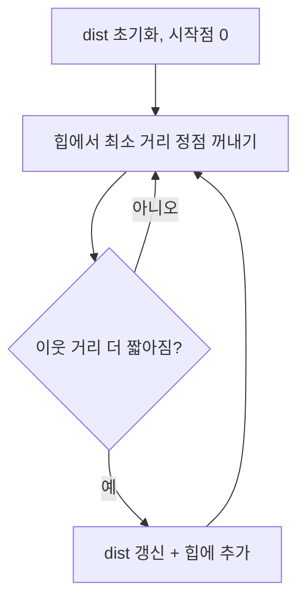



> 문제 출처는 각 플랫폼(백준·프로그래머스·카카오 등)이며, 문제 지문은 옮기지 않고 번호와 링크로 대신합니다. 풀이와 설명은 직접 작성한 것입니다.
{: .prompt-info }

## 🇰🇷 문제 상황
방향 그래프에서 시작점으로부터 **모든 정점까지의 최단 거리**를 구합니다. (백준 1753) 간선 가중치는 양수입니다.

## 아이디어
- `dist[]`를 무한대로 두고 시작점만 0으로 둡니다.
- 힙에서 **현재까지 가장 가까운 정점**을 꺼내, 그 정점을 거치면 더 짧아지는 이웃만 갱신하고 힙에 넣습니다.
- 가중치가 양수이므로 꺼낸 정점의 거리는 확정입니다.



## 핵심 코드
```python
from heapq import heappush, heappop
INF = 10**8

def dijkstra(start, graph, v):
    dist = [INF] * (v + 1)
    dist[start] = 0
    heap = [[0, start]]
    while heap:
        w, n = heappop(heap)
        if w > dist[n]:          # 이미 더 짧은 경로로 처리된 낡은 항목
            continue
        for nxt, cost in graph[n]:
            nw = w + cost
            if nw < dist[nxt]:
                dist[nxt] = nw
                heappush(heap, [nw, nxt])
    return dist
```
복잡도는 O(E log V)입니다.

## 배운 점
- 처음 풀이에는 `if w > dist[n]: continue`가 없었습니다. 답은 나오지만 **같은 정점을 여러 번 처리**합니다. 한 줄로 막을 수 있습니다.
- 간선 정보는 `graph[u].append([v, w])` 형태의 인접 리스트로 둡니다.
- 도달할 수 없는 정점은 `INF`를 그대로 출력하지 않고 "INF"로 바꿔 출력해야 하는 문제 조건을 놓치지 마세요.

## 🇺🇸 Summary
Dijkstra with a min-heap computes shortest paths from one source in O(E log V) for non-negative weights. Skip stale heap entries with `if w > dist[n]: continue`; my first version lacked this and reprocessed nodes.
