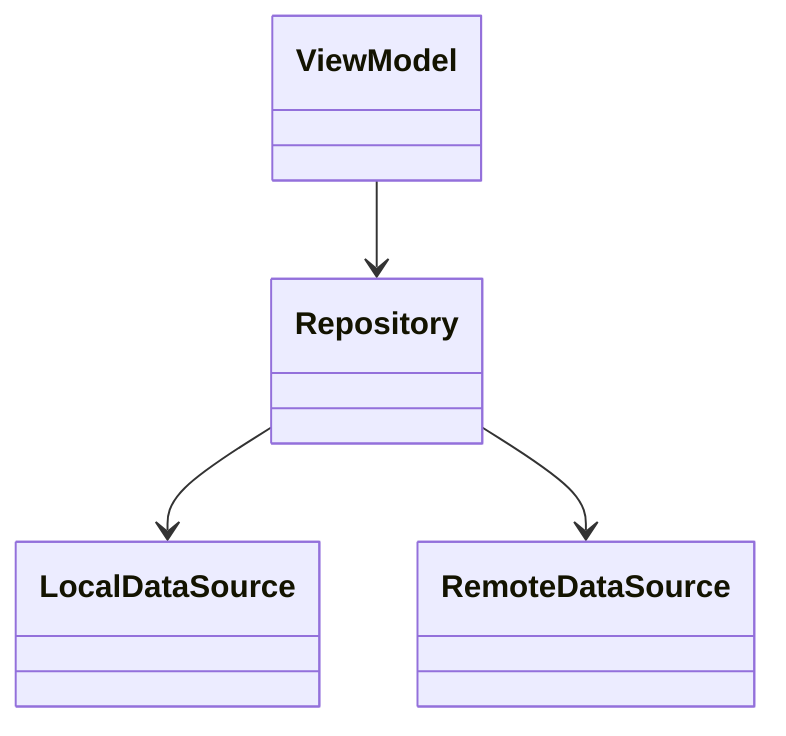



## 🇰🇷 왜 만들었나
클래스 수가 많은 코드를 받으면 가장 먼저 하고 싶은 일이 "전체 구조를 한눈에 보는 것"이었습니다. 비슷한 도구를 찾아봤지만 원하는 형태(로컬에서 바로 돌리고, 미리보기까지 되는)가 없어서 직접 만들었습니다. 다이어그램은 저만 보는 용도라 완성도보다 "일단 쓸 수 있으면 된다"는 기준으로 만들었습니다.

## 무엇을 만들었나
Python + Tkinter 기반 GUI 도구입니다.

1. 코드 폴더를 선택
2. Java 소스를 파싱해 클래스/상속/구현 관계를 추출
3. [PlantUML](https://plantuml.com/)로 다이어그램을 생성하고 화면에 미리보기


## 알려진 한계
- **Kotlin 파일을 인식하지 못함**
- **패키지가 하나만 있으면 다이어그램을 그리지 못함** (패키지 간 관계를 전제로 설계했기 때문)
- 두 UML을 패키지 기준으로 합치는 기능은 아직 없음

## exe로 배포하며 겪은 변화
처음에는 `pyinstaller --onefile`로 exe 하나만 뽑으면 끝이었습니다. 그런데 미리보기 화면과 로그 화면을 추가하면서 필요한 라이브러리가 늘었고, onefile 방식이 더 이상 안 통했습니다.

### 바뀐 배포 방식
1. `settings/` 폴더에 `plantuml.jar`와 렌더링에 필요한 라이브러리 파일들을 둡니다.
2. 빌드 명령을 `--onefile` 대신 폴더 방식으로 바꿉니다.
   ```bash
   pyinstaller --windowed --name "DiagramMaker" diagram_generator.pyw
   ```
3. 빌드 결과 폴더 안의 `_internal`에 `settings/` 내용을 복사해 넣습니다.
4. 그제서야 exe가 정상 동작합니다.

이 과정이 "약간 복잡해졌다"고 느꼈습니다. 뷰어를 따로 분리하거나 라이브러리를 바꾸는 식으로 더 개선할 여지가 있다고 봅니다.

### exe 배포와 보안
exe로 배포하면 소스를 쉽게 못 보게 되지만, 완전한 보안책은 아닙니다. PyInstaller로 만든 실행 파일은 추출 도구로 내부 바이트코드(`.pyc`)를 꺼낼 수 있고, 다시 디컴파일러로 원본에 가까운 파이썬 코드로 되돌리는 것도 가능합니다. 이런 도구들이 이미 공개돼 있어서, 기술 지식이 있으면 누구나 시도해볼 수 있습니다. "아예 못 보게" 보다는 "코드 환경 구성의 번거로움을 없애는" 목적으로 쓰는 게 더 맞다고 생각합니다.

## 예시
실제로 회사 코드에 돌려서 만든 다이어그램은 공개하지 않습니다. 대신 이 도구가 어떤 정보를 뽑아내는지 보여주는 가상의 예시입니다.



## 배운 점
- 기능을 하나씩 늘릴 때마다 배포 환경이 함께 복잡해진다는 걸 몸으로 배웠습니다. **배포 방식을 바꿀 때는 빌드 산출물을 전부 지우고 처음부터 다시 빌드**해야 꼬이지 않습니다.
- "남이 안 만드니까 내가 만든다"는 동기로 시작한 도구라도, 쓰다 보면 한계(Kotlin 미지원 등)가 명확히 보입니다. 다음 도구(Kani Diagram)를 만들 때 이 한계를 의식하게 됐습니다.

## 🇺🇸 Summary
Built a small Python/Tkinter GUI that parses Java source into class/inheritance relationships and renders a PlantUML class diagram with live preview — something I wanted but couldn't find pre-made. It can't parse Kotlin and needs more than one package to draw anything. Adding a preview and log view broke the single-file PyInstaller build, forcing a switch to folder-mode packaging with bundled PlantUML/runtime assets. Also noted that a PyInstaller exe isn't real protection — decompiling it back to near-original Python is a well-documented two-step process.
