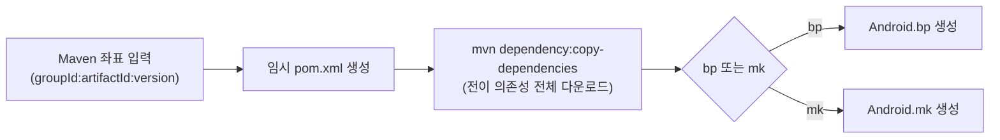



## 🇰🇷 문제
AOSP 환경에서 외부 라이브러리(AndroidX 등)를 쓰려면, 그 라이브러리가 의존하는 다른 라이브러리까지 전부 찾아서 빌드 시스템에 추가해야 합니다. `mvnrepository.com` 같은 사이트에는 직접 의존성만 보이기 때문에, 실제로 필요한 **전이 의존성(Transitive Dependencies)**은 훨씬 많습니다. 예를 들어 `appcompat` 라이브러리 하나만 써도 `activity`, `fragment`, `lifecycle` 등 수많은 하위 라이브러리가 연쇄적으로 딸려 옵니다. 이걸 손으로 추적하는 건 거의 불가능에 가깝습니다.

## 접근
Python 스크립트 하나로 끝나는 흐름을 만들었습니다.



### 핵심 동작
1. **임시 `pom.xml` 생성**: 사용자가 지정한 라이브러리 하나를 의존성으로 선언한 최소한의 Maven 프로젝트를 임시 폴더에 만듭니다. Google의 Maven 저장소와 Maven Central을 저장소로 등록합니다.
2. **전이 의존성 다운로드**: `mvn dependency:copy-dependencies`로 전체 의존성 트리에 포함된 `.aar`/`.jar`를 한 번에 받습니다.
3. **빌드 파일 생성**: 다운로드된 라이브러리들을 모아 `Android.bp`(최신 Soong 빌드 시스템) 또는 `Android.mk`(레거시) 파일을 자동으로 만듭니다. 개별 모듈을 묶는 통합 모듈도 함께 생성해서, 다른 빌드 파일에서는 이름 하나만 추가하면 모든 의존성을 쓸 수 있습니다.

### 사용법
```bash
python depen_killer.py androidx.media3:media3-exoplayer:1.8.0 media3_libs bp
#                       <groupId:artifactId:version>          <출력 폴더> <bp|mk>
```

### 사전 조건 점검
Python, JDK, Maven이 PATH에 잡혀 있는지 먼저 확인하고, 하나라도 없으면 설치 가이드를 바로 출력하도록 만들었습니다. "명령어가 없는데 알 수 없는 오류만 뜨는" 상황을 줄이기 위해서입니다.

## 결과
처음 만든 뒤, 실제로 몇몇 라이브러리를 추가하며 다운로드 경로·모듈명 처리 관련 디테일을 조금씩 고쳤습니다. 한 줄 명령으로 전이 의존성 전체를 받아 바로 쓸 수 있는 빌드 파일이 나온다는 점이 가장 체감 큰 변화였습니다.

## 배운 점
- **반복 작업은 "자동화하면 편하다" 정도가 아니라, 안 하면 실수가 누적된다.** 의존성을 손으로 추적하다 빠뜨리는 라이브러리가 꼭 하나씩 있었습니다.
- Maven의 의존성 해석 기능을 그대로 활용하면, 직접 트리를 순회하는 코드를 짤 필요가 없습니다. 이미 있는 도구의 출력을 다음 단계 입력으로 쓰는 게 가장 적은 코드로 끝나는 방법이었습니다.

## 🇺🇸 Summary
Adding an external library to AOSP meant manually tracking every transitive dependency and wiring it into the build system — tedious and error-prone. This script automates the whole chain: generate a throwaway `pom.xml` for the target library, let Maven resolve and download the full transitive dependency tree, then auto-generate an `Android.bp` or `Android.mk` (plus a combined module so other build files need only one reference). Leaning on Maven's own dependency resolution instead of reimplementing tree traversal kept the script small.
