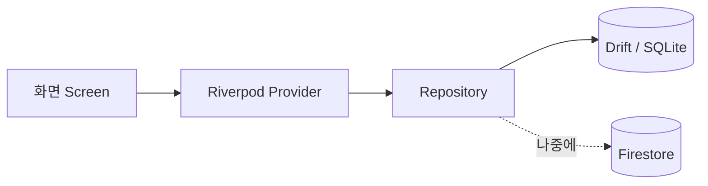





## 🇰🇷 무엇을 만드나
**Data Collector**는 내가 모으고 싶은 정보를 한 앱에 쌓는 개인용 Flutter 앱입니다.

- **인물 위키**: 사람 이름, 사진, 자유 형식 속성(키-값)
- **뉴스 아카이브**: 기사 요약, 이미지, 태그, 타임라인
- **지도 트래커**: GPS로 이동 경로를 기록하고 다시 보기

목표는 두 가지였습니다. **크로스 플랫폼**(모바일·데스크톱·웹)과 **오프라인에서도 동작하다가 온라인이 되면 클라우드와 동기화**하는 것입니다.

## 결정한 것 4가지
| 영역 | 선택 | 이유 |
|---|---|---|
| 상태관리 | Riverpod (코드 생성 방식) | 비동기 데이터를 다루기 쉽고, 컴파일 시점에 오류를 잡을 수 있음 |
| 폴더 구조 | feature-first | `lib/features/<기능>/data·domain·presentation`으로 기능별 모듈화 |
| 로컬 DB | Drift (SQLite 추상화) | 지도·뉴스처럼 범위 검색·정렬 같은 쿼리가 많음 |
| 백엔드 | Firebase (Firestore, Hosting, Storage) | 온라인에서는 클라우드, 오프라인에서는 로컬 DB를 쓰는 하이브리드 |

### 폴더 구조
```
lib/
├── main.dart        # 진입점 (엔진·Firebase 초기화)
├── app.dart         # 전역 설정 (Theme, Router)
├── core/            # 공통 유틸·위젯·상수
├── data/            # 전역 데이터 소스 (local / remote)
├── features/        # 기능별 모듈 (map / person / news)
└── shared/          # 여러 기능이 같이 쓰는 위젯
```
기능 하나를 고칠 때 폴더 한 곳만 열면 되는 구조입니다. 계층별(`models/`, `services/`)로 나누면 기능 하나를 고칠 때마다 여러 폴더를 오가야 해서 이쪽을 골랐습니다.

### 계층 구조
처음에는 인물 목록 화면 하나를 세로로 끝까지 연결하는 것부터 시작했습니다.

{: w="700" }
_UI → Provider → Repository → Drift DB. 웹과 네이티브는 연결 파일만 다르게 가져간다._



## 첫날 작업 순서
하루에 뼈대를 세웠습니다.

1. `pubspec.yaml`에 Riverpod, Drift, Firebase, GoRouter, build_runner 추가
2. `main.dart`: 엔진 바인딩과 Firebase 초기화 후 `ProviderScope`로 앱을 감싸 실행
3. `app.dart`: `MaterialApp.router`와 GoRouter 설정, 임시 홈 화면 연결
4. Drift 스키마: 인물(JSON 확장 필드), 뉴스, 지도 로그 3개 테이블
5. DB 인스턴스를 Provider로 등록 (`ref.read(databaseProvider)`로 어디서든 접근)

### 배운 점 두 가지
- **JSON 필드로 스키마 변경을 줄인다.** 인물 테이블의 `attributes`를 JSON 변환기로 `Map`처럼 저장하면, 속성이 늘어도 마이그레이션이 필요 없습니다.
- **코드 생성 충돌은 지우고 다시 만든다.** 생성 파일이 꼬이면 아래 순서가 가장 빨랐습니다.
  ```bash
  flutter clean
  flutter pub get
  dart run build_runner build --delete-conflicting-outputs
  ```

> 이 개발 로그는 AI 도구의 도움을 받아 정리하며 썼습니다. 결정과 구현은 직접 했고, 문서화에 AI를 썼다는 점을 밝혀 둡니다.
{: .prompt-info }

다음 글에서는 인물 위키와 뉴스 아카이브를 구현하고 로컬 DB를 Firestore로 바꾼 과정을 다룹니다.

## 🇺🇸 Summary
Data Collector is a personal Flutter app for collecting people, news and GPS tracks. I chose Riverpod (code generation), a feature-first folder layout, Drift (SQLite) for local queries and Firebase for cloud sync, aiming for cross-platform use and offline-first behaviour. Day one covered dependencies, app entry, router, the Drift schema (with a JSON attributes field to avoid migrations) and a global database provider.
