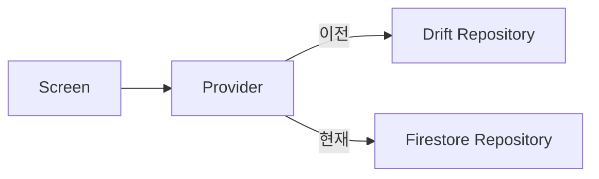





## 🇰🇷 로컬 DB로 먼저 완성하기 (1월 22일 ~ 2월 5일)
Firebase를 붙이기 전에 로컬 Drift DB로 두 기능을 끝까지 만들었습니다. 한 번에 하나씩 확인하려는 의도였습니다.

### 기능 1: 인물 위키
- `PersonRepository`: 이름, 나이, 이미지 URL, 동적 속성(Map)을 저장하고 조회하는 CRUD
- `PersonListScreen`: 목록 조회, 추가 다이얼로그
- `PersonDetailScreen`: 선택한 인물의 정보와 **Wiki Data(JSON 속성)** 표시
- GoRouter의 `extra`로 객체를 넘겨 목록 → 상세 흐름 구현

### 기능 2: 뉴스 아카이브
- `NewsRepository`: Drift의 `orderBy`로 최신순 조회
- 타임라인 형태의 카드 목록, 입력 화면, 이미지와 긴 본문을 보여 주는 상세 화면

### 막혔던 점
- Drift가 생성하는 클래스 이름(`Person` vs `PeopleData`)이 코드에서 쓰던 이름과 달라 컴파일 오류가 났습니다. 생성된 이름을 기준으로 맞췄습니다.
- 웹 빌드에서 Drift가 동작하지 않아 일단 가짜(Fake) DB로 우회했습니다. 이 문제는 다음 글에서 제대로 풀었습니다.

## Firestore로 갈아타기 (2월 5일 ~ 8일)
원래 계획은 3번째 기능인 지도였지만, 먼저 **데이터를 클라우드에 올리는 것**으로 순서를 바꿨습니다. 웹과 앱 어디서든 같은 데이터를 보고 싶었기 때문입니다.

### DB 선택: Realtime Database vs Firestore
| 특성 | Realtime DB | Cloud Firestore |
|---|---|---|
| 구조 | 큰 JSON 트리 | 문서·컬렉션 |
| 쿼리 | 제한적 | 복합 필터, 정렬, 페이징 |
| 확장 | 데이터가 늘면 성능 우려 | 자동 확장 |
| 과금 | 전송량 기준 | 읽기·쓰기 횟수 기준 |

인물과 뉴스는 관계가 있는 구조화된 데이터이고 "최신순", "나이 20세 이상" 같은 쿼리가 필요하므로 **Firestore**를 골랐습니다.

### 연결 순서
```bash
firebase login
dart pub global activate flutterfire_cli
flutterfire configure   # lib/firebase_options.dart 생성
```

### 전환 방식: Repository만 교체
기존 Drift 코드는 지우지 않고, **Firestore용 Repository를 새로 만들어 Provider 연결만 바꿨습니다.** 화면 코드는 Repository 인터페이스만 알기 때문에 UI는 거의 건드리지 않았습니다. 필요하면 로컬 모드로 되돌릴 수도 있습니다.



### 뉴스 모델 정리 (2월 10일)
인물과 뉴스의 구현 방식이 달라 유지보수가 불편해서 통일했습니다.

- `freezed`와 코드 생성을 걷어내고, 둘 다 **순수 Dart 모델 + 일반 Provider** 구조로 맞춤
- Firestore `Timestamp`와 `DateTime` 변환을 모델의 `fromMap`/`toMap` 안으로 이동
- `withConverter`로 입출력 변환을 자동화
- 뉴스 분류용 **태그(`List<String>`)** 필드 추가
- 별도 추가 화면을 없애고 목록 화면의 다이얼로그로 통합해 작업 흐름이 끊기지 않게 함

### 배운 점
- **교체 지점을 한 곳(Repository)에 모아 두면 저장소를 바꾸는 비용이 작다.**
- 같은 앱 안의 기능끼리는 패턴을 통일해야 나중에 읽기 쉽다. 일부만 코드 생성을 쓰는 구성은 오히려 부담이었다.

## 🇺🇸 Summary
I built the Person Wiki (with JSON-based dynamic attributes) and News Archive on local Drift first, then migrated to Cloud Firestore for cross-device access by swapping only the repository behind the providers. Firestore won over Realtime DB for relational data and richer queries. I also unified both features on plain Dart models with `withConverter`, added tags to news, and replaced the add screen with a dialog.
