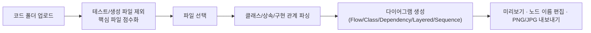



## 🇰🇷 Kani Diagram — 핵심 파일부터 찾아주는 다이어그램 도구
2편에서 만든 PlantUML 생성기는 Kotlin을 못 읽고, 패키지가 여러 개 있어야만 동작하는 한계가 있었습니다. 그 한계를 의식하면서, 이번엔 다른 접근으로 다시 만들었습니다. Flutter Web 기반이고, **어떤 파일부터 봐야 하는지 점수로 알려주는 것**이 핵심입니다.

### 동작 방식

- **점수화 기준**: 클래스/상태관리/서비스/비동기/Firestore 관련 키워드를 기반으로 점수를 매겨, 핵심 파일 후보를 정렬된 리스트로 보여줍니다.
- **다이어그램 5종**: Flow, Class, Dependency, Layered, Sequence 중 목적에 맞게 고를 수 있습니다.
- **용량 경고**: 선택한 파일의 총 용량이 4MB를 넘으면 미리 경고합니다.
- **저장**: Firestore에 다이어그램을 저장·조회할 수 있습니다.
- **업로드 파일은 생성이 끝나면 메모리에서 즉시 삭제**합니다. 코드를 서버에 남기지 않으려는 의도입니다.

### 웹이라서 생긴 제약
브라우저 보안 정책상 로컬 파일 경로에 임의로 접근할 수 없어서(`dart:io` 사용 불가), 지금은 파일 선택 업로드 방식으로만 동작합니다. 데스크톱/서버로 확장할 때를 대비해 `dart:io` 기반 구현 코드는 미리 분리해 뒀습니다.

### 2편과 비교해 나아진 점
| | PlantUML 생성기 (2편) | Kani Diagram |
|---|---|---|
| 실행 환경 | 로컬 exe | 웹 |
| 언어 지원 | Java만 | Java/Kotlin 포함 다양한 소스 |
| 시작점 | 폴더 전체를 보여줌 | 핵심 파일부터 점수로 추천 |
| 배포 | PyInstaller 패키징 고민 | Firebase Hosting으로 간단히 배포 |

"어디부터 봐야 할지" 추천해주는 기능이 가장 크게 달라진 점입니다. 코드가 많을수록 입구를 찾는 게 가장 큰 비용이었기 때문입니다.

## 아직 구현하지 못한 것: 패치 추적 구상
이 시리즈를 시작한 또 다른 동기는 **SoC 벤더, 고객사, 구글 각각이 올리는 패치가 코드베이스에 어떤 영향을 주는지 추적하는 도구**를 만들고 싶었던 것입니다. 하지만 이 부분은 지금까지 설계 수준의 구상만 있고, 실제로 구현하지는 못했습니다.

지금까지 생각해 둔 방향은 이렇습니다.

- 패치를 **출처(벤더/고객사/구글)** 기준으로 분류하고, 각 패치가 건드린 파일·모듈을 추적
- 2~4편에서 만든 다이어그램 도구들을 "패치 전/후 구조 비교"에 활용 — 같은 모듈을 패치 전후로 각각 다이어그램으로 뽑아 비교하면 영향 범위가 더 선명해질 것으로 예상
- 패치가 몰리는 모듈을 시간순으로 누적해서 보여주면, 어디가 자주 바뀌는 "위험 지역"인지 드러날 것으로 기대

세 도구(의존성 변환기, PlantUML 생성기, Kani Diagram)는 모두 이 큰 그림의 부품으로 시작했지만, 실제로는 각자 독립적으로 쓸모가 있어서 패치 추적 없이도 계속 쓰고 있습니다. 패치 추적 자체는 데이터(어떤 패치가 언제 어디를 건드렸는지)를 체계적으로 모아야 의미가 있는데, 아직 그 단계까지 가지 못했습니다.

## 시리즈를 마치며
세 도구 모두 "완성된 제품"이 아니라 "지금 겪는 문제를 조금 줄여주는 스크립트"로 시작했고, 지금도 그 수준에 머물러 있습니다. 그래도 반복 작업(의존성 추적)과 눈으로 쫓기 힘든 구조(코드 관계)를 줄여준 것만으로도 충분히 가치가 있었습니다. 패치 추적은 언젠가 데이터가 쌓이면 다시 시도해볼 생각입니다.

## 🇺🇸 Summary
Kani Diagram is a Flutter Web rewrite that addresses the previous tool's limits: it scores uploaded files to recommend where to start reading, supports more languages, and offers five diagram types, deployed simply via Firebase Hosting. The larger motivation behind this whole series — tracking how patches from different sources (SoC vendor, customer, Google) affect the codebase over time — remains an unimplemented idea: compare per-module diagrams before/after a patch, and accumulate patch history to surface frequently-changed "hot" modules. None of the three tools depend on that idea to be useful on their own, so patch tracking stays a future direction rather than a built feature.
