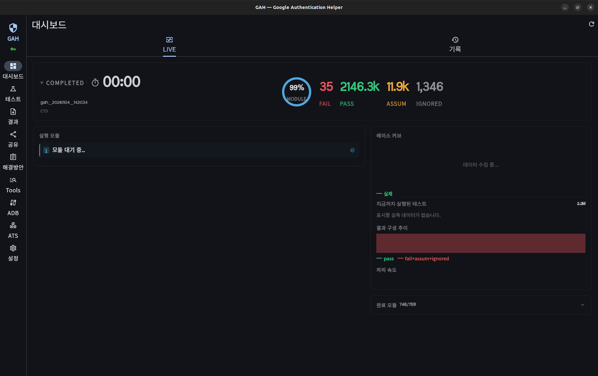
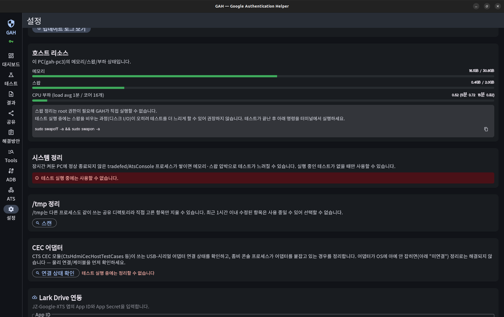



> 이 글이 다루는 실제 작업 기간: **2026-08-26 ~ 2026-10-07**
{: .prompt-tip }

## 🇰🇷 무엇을 만들었나
테스트가 지금 얼마나 진행됐는지를 한눈에 보여주는 대시보드를 계기판형 레이아웃으로 전면 개편했습니다. 샤드별 레인(어느 기기가 무엇을 하고 있는지), 완료 모듈 목록, 실시간 성능 비교(현재 속도 vs 과거 평균) 등을 붙였습니다.

{: w="1200" }
_테스트가 막 끝난 시점이라 그래프는 비어 있지만, 실행 중에는 레이스 커브와 처리 속도가 실시간으로 채워진다._

## 실사용 사고
테스트 실행 중 기기 한 대만 고치려고 "ADB 서버 재시작"을 눌렀는데, 테스트 프레임워크가 서버 소실을 감지해 동시 재시작을 시도하면서 **다른 정상 기기들까지 연쇄로 오류를 겪은 사고**가 있었습니다.

재현 가능한 위험으로 확인한 뒤, 위험한 버튼에는 확인 대화상자를 달고 "기기 한 대만 재연결"하는 안전한 대안을 새로 만들었습니다.

## 그 외 개선
- 호스트 리소스(메모리/스왑/부하) 모니터링: 실제로 테스트가 느려졌던 날의 리소스 수치와 재부팅 후 정상화된 수치를 비교해 상관관계를 확인한 뒤 만들었습니다.

{: w="1200" }
_스왑 정리는 root 권한이 필요해 자동화하지 않고 명령어만 안내한다. 테스트 중에는 정리 버튼 자체를 막아 둔다._
- 장기 가동 PC에 쌓이는 고아 프로세스 정리 기능: 처음엔 자동 종료로 제안됐지만, 실행 중인 테스트를 오인 종료할 위험 때문에 **유휴 상태일 때만 눌리는 수동 버튼**으로 방향을 바꿔 구현했습니다.

## 배운 점
"위험한 동작은 영향 범위를 먼저 좁히고, 자동화보다 확인을 앞세운다"가 이 구간의 핵심이었습니다. 특히 한 기기를 고치려는 조작이 다른 기기에 영향을 주는 구조는, 겪기 전까지는 예상하기 어려웠습니다.

## 🇺🇸 Summary
Rebuilt the progress dashboard as a gauge-style real-time view (per-device lanes, completed modules, current-vs-historical speed). A real incident occurred when restarting the ADB server to fix one device caused the test framework to detect the lost connection and trigger simultaneous restarts, cascading errors to otherwise-healthy devices — fixed with a confirmation dialog on risky buttons and a safer "reconnect just this device" action. Also added host resource monitoring (correlated against an actual slowdown incident) and an orphan-process cleanup that was deliberately kept manual and idle-only to avoid killing a running test by mistake.
