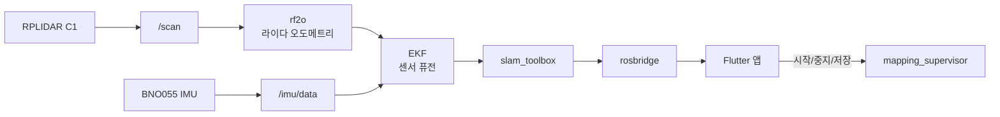



## 🇰🇷 한 줄 소개

**RPLIDAR C1 + IMU(BNO055) + Orange Pi 4 Pro**를 백팩 어깨끈에 달고 걸어 다니면서 실내 2D 지도(로봇청소기 수준)를 만들고, 스마트폰 앱(Flutter)으로 실시간 확인·저장하는 개인 프로젝트입니다.

> 아직 **완성 전**입니다. 지금은 필드 테스트를 반복하며 지도 정확도를 올리는 단계이고, 이 시리즈는 그 과정을 개발 로그에서 골라 나눠 정리합니다.
{: .prompt-info }

{: w="700" }
_어깨끈 마운트 컨셉 렌더 (실제 부품은 3D 프린트한 브래킷으로 제작)_

## 왜 만들었나
- 바퀴가 없는 **사람 휴대형** 장비로 SLAM을 해보고 싶었습니다. 바퀴 엔코더가 없으니 방향 추정이 약하고, 걸음에 따른 흔들림도 크다는 점이 흥미로운 문제였습니다.
- 하드웨어(센서·보드)부터 ROS2, 모바일 앱, 데이터 저장까지 **풀스택으로 직접 연결**해 보는 것이 목표입니다.

## 전체 구조

- 모든 ROS2 노드는 **Docker 컨테이너** 안에서 동작해서 PC와 Orange Pi에 같은 이미지를 그대로 씁니다.
- 계층 간 통신은 ROS2 토픽으로만 하고, 라이다·AI 같은 구성요소는 어댑터로 감싸 교체가 쉽게 설계했습니다.

## 진행 타임라인

{: w="900" }
_2026-08-31 개발환경 구축부터 2026-10-01 첫 필드 테스트까지의 흐름_



## 시리즈 목차 (시간 순)


목록으로 보기

1. 프로젝트 개요 (이 글)
2. 보드 선택과 폼팩터 전환 — Raspberry Pi 5에서 Orange Pi 4 Pro로
3. IMU가 I2C에서 안 잡힐 때 — 범인은 납땜 안 된 두 핀
4. EKF 센서 퓨전의 함정 — 위치와 방향을 분리하면 지도가 깨진다
5. 지도가 이상할 땐? 세션 제어와 자동 저장 설계
6. 정확도 올리는 중 — 드리프트 진단 도구와 필드 테스트 프로토콜

## 🇺🇸 Summary

A personal project: a backpack-mounted rig (RPLIDAR C1 + BNO055 IMU + Orange Pi 4 Pro) that builds indoor 2D maps while walking, with a Flutter app for live view and saving. ROS2 nodes run in Docker, so the same image runs on a PC and on the board. The project is still in progress and currently in field-test and accuracy-tuning phase; this series walks through the key decisions and debugging stories from my dev log.
