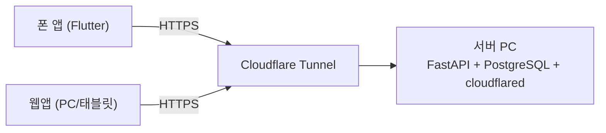



## 🇰🇷 스택 결정

| 영역 | 선택 | 이유 |
|---|---|---|
| 모바일 앱 | **Flutter** | Google ML Kit OCR(한국어 인식)과 통합이 좋고, 카메라 패키지가 안정적이며, 추후 위키 애니메이션에 유리. 구글 플레이 단독 목표라 iOS는 당장 불필요 |
| 백엔드 | **Python + FastAPI + SQLAlchemy** | 향후 카메라/센서 연동(OpenCV 등), 통계 분석(pandas 등) 확장에 유리 |
| DB | **PostgreSQL** (서버 PC에 로컬 설치) | 무료, 표준 백업/복원(`pg_dump`/`restore`)으로 이전이 쉬움 |

## 네트워크: Tailscale에서 Cloudflare Tunnel로

처음에는 서버와 폰 앱을 **Tailscale**(메시 VPN)로 연결하려 했습니다. 포트포워딩 없이 안전하다는 장점이 있었습니다. 하지만 사용자 입장에서 따져 보니 문제가 보였습니다.

- 농부가 **별도 VPN 앱을 설치·로그인**해야 한다 → 현장 사용성에 불리
- 향후 고객 직접 주문 화면은 어차피 VPN 밖이라 별도 공개 경로가 필요

그래서 **Cloudflare Tunnel(cloudflared)** 로 바꿨습니다. 앱은 일반 HTTPS 주소로 접속하면 되고, 와이파이든 모바일 데이터든 동일하게 동작하며, 터널 자체는 무료입니다.

| | Quick Tunnel | Named Tunnel |
|---|---|---|
| 주소 | 임시(`*.trycloudflare.com`), 재시작 시 변경 | 내 도메인의 고정 주소 |
| 비용 | 무료 | 도메인 구매 필요(연 1만원대) |
| 용도 | **개발·테스트 (현재)** | 서비스 안정화 후 전환 |

> 도메인은 서비스가 정상 동작하는 것을 확인한 뒤에 구매하기로 했습니다. 비용을 쓰기 전에 가치를 먼저 검증하는 순서입니다.
{: .prompt-tip }

## 서버 구성과 이동성

- API 서버와 DB를 **한 대의 PC**에 같이 둡니다(Windows/macOS 모두 가능한 크로스플랫폼 구성). 대신 이 PC는 업무 시간에 항상 켜져 있어야 하고, 노트북이라면 절전 모드를 꺼야 합니다.
- 개발 단계에서는 개발용 PC가 서버 역할을 겸하고, 서비스가 안정되면 다른 기기로 옮기거나 유지할지 결정합니다.
- **옮길 수 있게** 처음부터 DB 접속 정보(호스트/포트/비밀번호)를 코드에 넣지 않고 `.env` 설정 파일로 분리합니다. 서버를 옮길 때는 설정값만 바꾸고 `pg_dump`로 데이터를 이전합니다.
- 코드는 GitHub에 올려 어느 기기에서든 이어서 작업할 수 있게 합니다.

## 아직 정하지 않은 것
DB 세부 스키마, OCR 구체 구현 방식, GitHub 저장소 구성은 **추측하지 않고 하나씩 확인하며 결정**할 예정입니다.

## 🇺🇸 Summary

Stack: Flutter (ML Kit OCR with Korean support, stable camera plugins), FastAPI + SQLAlchemy (room for OpenCV/pandas later), and a local PostgreSQL. I first planned Tailscale but switched to Cloudflare Tunnel because farmers shouldn't need a VPN app and the future customer-facing order page needs a public path anyway. Development uses a free Quick Tunnel; a domain and Named Tunnel come after the service proves itself. API, DB and tunnel run on one always-on PC, with DB credentials kept in `.env` and `pg_dump`/restore for easy migration.
