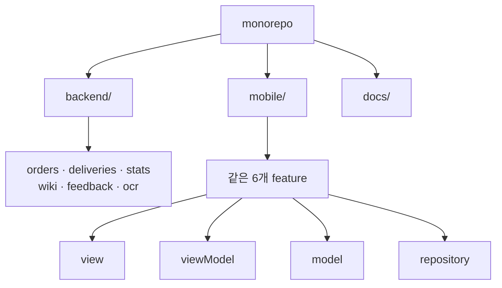





## 🇰🇷 결정한 것
규모가 커질 수 있는 프로젝트라, 코드를 쓰기 전에 **폴더 구조와 책임 분리**부터 정했습니다. 결정 과정은 저장소의 `docs/devlog/0001-architecture-decision.md`에도 기록했습니다.

### 1. 모노레포
`backend/`, `mobile/`, `docs/` 세 폴더를 한 저장소에 둡니다. 혼자 개발하고 API 스키마가 앱과 같이 바뀌므로, 저장소를 나누는 이득보다 변경을 한 번에 추적하는 이득이 큽니다.

### 2. 계층형이 아닌 기능별 모듈(Feature-based)
`controllers/`, `services/`, `models/`처럼 **계층으로** 나누면 기능 하나를 고칠 때 폴더 여러 곳을 오가야 합니다. 그래서 **기능 단위**로 나눴습니다.

| 모듈 | 역할 |
|---|---|
| orders | 주문 |
| deliveries | 배송 |
| stats | 통계 |
| wiki | 업무 위키 |
| feedback | 피드백 |
| ocr | 주문서 인식 |

백엔드 모듈은 각각 `models / schemas / service / router`를, 앱 feature는 각각 `view / viewModel / model / repository`를 가집니다.

### 3. Flutter: MVVM + Riverpod
화면(view)은 그리기만 하고, 상태와 로직은 viewModel, 데이터 접근은 repository로 분리합니다. 상태관리는 Riverpod으로 정했습니다. OCR이나 통계처럼 화면 밖에서 상태를 공유할 일이 늘어날 것을 고려했습니다.

## 현재 상태 (솔직하게)
- 폴더와 **스텁 파일만** 만들었습니다. 백엔드 6개 모듈, 앱 6개 feature가 모두 **빈 틀**이고 실제 로직, DB 스키마, 화면은 아직 없습니다.
- OCR은 온디바이스(ML Kit)로 할지 클라우드로 할지도 **아직 미정**입니다.
- 코드 저장소 공개 여부가 정해지지 않아, 이 글에는 저장소 링크를 넣지 않았습니다.
- 앱 화면이 아직 없어서 이번 글에는 캡처가 없습니다. 첫 화면이 생기면 더미 데이터로 보여드리겠습니다.

진행률은 설계 쪽만 조금 올랐고, 구현 항목은 구조만 잡혔을 뿐이라 한 자리 수로 두었습니다.

## 다음
DB 스키마 설계와 주문 기능의 첫 API, 그리고 OCR 방식 결정이 다음 글의 후보입니다.

## 🇺🇸 Summary
Before writing features, I fixed the structure: a monorepo (`backend/`, `mobile/`, `docs/`) organized by **feature modules** (orders, deliveries, stats, wiki, feedback, OCR) instead of technical layers. The Flutter app uses MVVM per feature (view / viewModel / model / repository) with Riverpod. Both backend and app are currently empty scaffolds with no real logic, and the OCR approach (on-device vs. cloud) is still undecided. The decision is recorded in an architecture note in the repo. No screenshots yet because no UI exists.
