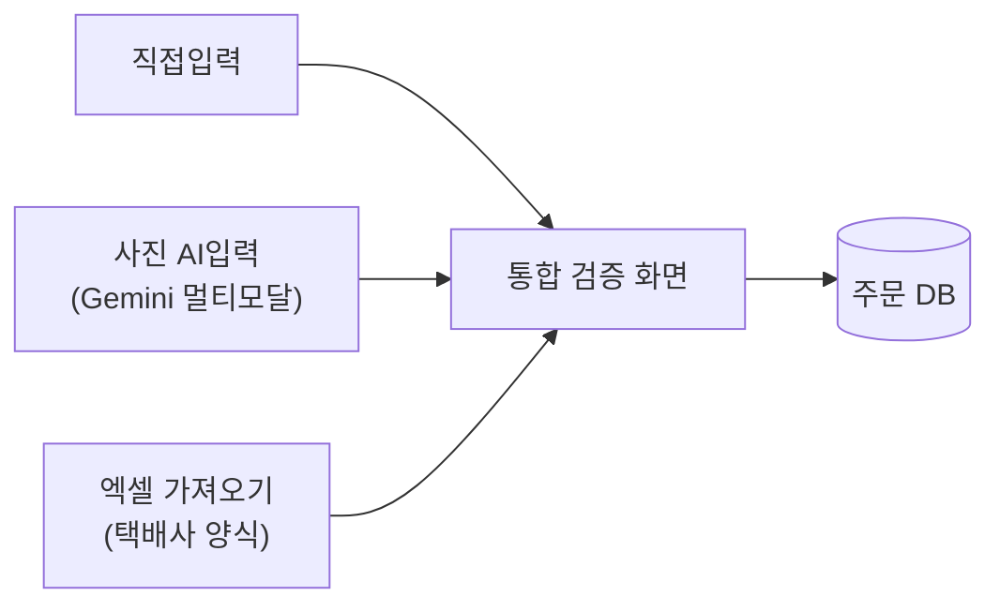





## 🇰🇷 문제
1편에서 정리했듯, 주문은 손글씨·문자·엑셀 캡처 등 제각각의 형태로 들어옵니다. 입력 경로를 하나로 강제할 수 없는 상황이라, **경로는 여러 개로 열어 두고 검증만 하나로 모으는** 방향을 택했습니다.

## 입력 경로 3가지
| 경로 | 방식 |
|---|---|
| 직접입력 | 폼에 바로 타이핑 |
| 사진 AI입력 | 사진을 찍으면 Gemini 멀티모달로 손글씨·문자·엑셀 캡처를 인식해 자동 채움 |
| 엑셀 파일 가져오기 | 택배사 지정 양식 엑셀을 그대로 불러오기 |

세 경로 모두 결과적으로 같은 데이터 구조로 떨어지게 만들고, **입력 경로와 무관하게 한 화면에서** 검증을 거치도록 했습니다. 경로별로 검증 로직을 따로 두면 나중에 한쪽만 고치고 다른 쪽을 놓치는 실수가 날 게 뻔했습니다.

## 통합 검증
- **주소 실존 확인**: 카카오 주소 API로 입력된 주소가 실제로 존재하는지 확인
- **상세주소 패턴 검증**: 동/호 표기의 오타, 숫자에 문자가 섞인 경우, 상식 밖의 호수(예: 존재할 수 없는 층수) 같은 패턴을 걸러냄
- **전화번호 형식 검증**

세 가지를 **입력이 끝나는 단일 화면**에서 한 번에 처리합니다. OCR이나 엑셀 가져오기에서 생긴 오류든, 사람이 직접 입력하다 낸 오타든 같은 기준으로 걸러진다는 뜻입니다.

## 배운 점
"입력 경로를 통일한다"는 목표를 세우면 오히려 현장 상황(현실에서는 손글씨도, 엑셀도, 직접 입력도 다 생긴다)과 부딪힙니다. **입구는 여러 개로 열어 두고 출구(검증)를 하나로 모으는** 쪽이 현실적이면서도 일관성을 지키는 방법이었습니다.

## 🇺🇸 Summary
Orders arrive in three different shapes in practice, so instead of forcing one input method I kept three entry paths (manual typing, photo-based AI recognition via Gemini for handwriting/texts/spreadsheet screenshots, and direct import of the courier's Excel template) that all funnel into one shared validation screen — address existence via a map API, detail-address pattern checks, and phone format checks — so every order is held to the same standard regardless of how it arrived.
