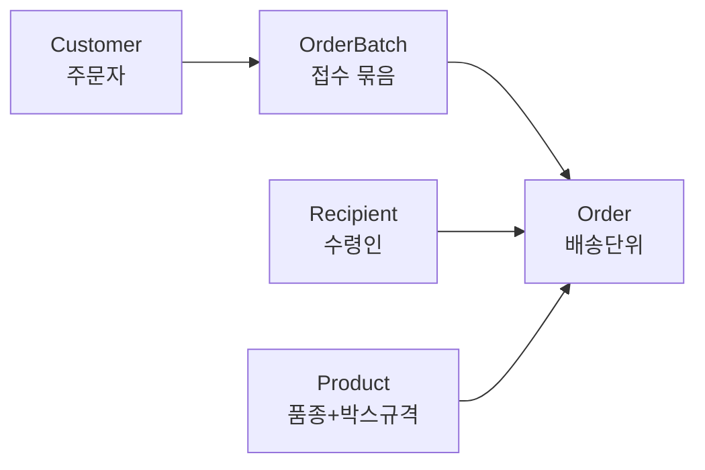





## 🇰🇷 테이블 구조
주문 데이터를 다섯 개 테이블로 나눴습니다.

- **Customer(주문자)**: 주문을 넣는 사람
- **Recipient(수령인)**: 실제로 받는 사람. 한 번 주문에 수령인이 여러 명일 수 있어 분리
- **Product**: 품종과 박스 규격을 묶은 단위
- **OrderBatch**: 한 번에 접수된 주문 묶음(엑셀 한 번 업로드, 사진 한 장 등)
- **Order**: 실제 배송 단위. 수령인 1명당 Order 1건

## 재사용을 위한 설계
재주문이 잦은 농산물 특성상, 주문자·수령인·상품을 매번 새로 입력하는 건 비효율적입니다. 그래서 세 마스터 테이블을 **주소록처럼** 다루기로 했습니다. 새 주문이 들어오면 먼저 이름·연락처·주소로 기존 레코드를 찾고, 있으면 FK로 연결하고 없으면 새로 만듭니다. 신규 입력은 "처음 보는 사람/상품"일 때만 발생합니다.

Customer에도 Recipient와 똑같이 주소 필드를 둔 이유는, **주문자가 본인에게도 배송을 받는 경우**(자가소비용 주문)를 그냥 Recipient 레코드 하나 더 만드는 것으로 처리할 수 있게 하기 위해서입니다. 두 테이블을 같은 모양으로 만들어두면 이런 경계 케이스에서 특수 분기를 안 둬도 됩니다.

## 개인정보: 동의 플래그 대신 삭제 요청 시각
별도의 "개인정보 수집 동의" 플래그를 두는 대신, `delete_requested_at`(삭제 요청 시각) 컬럼 하나만 뒀습니다. 배송이 완료되는 시점에 "정보를 삭제해드릴까요?"를 묻고, 동의하면 이 컬럼에 시각을 기록합니다. 동의 자체를 추적하는 복잡한 구조보다, **삭제를 요청했는지 아닌지**만 보는 쪽이 지금 규모에서는 충분하다고 판단했습니다.

## 배운 점
마스터 테이블을 분리하는 설계는 처음엔 과한 추상화처럼 보였지만, 재주문이 실제 운영에서 압도적으로 많다는 걸 알고 나니 당연한 선택이 됐습니다. Customer와 Recipient를 동일한 모양으로 만들어둔 것도, 나중에 "주문자=수령인" 같은 경계 케이스를 특수 처리 없이 흡수했습니다.

## 🇺🇸 Summary
The order schema splits into five tables: Customer (who places the order), Recipient (who actually receives it — a single order can have multiple recipients), Product (variety + box-size combo), OrderBatch (one intake event — one Excel upload or one photo), and Order (the actual delivery unit, one per recipient). Customer, Recipient and Product are treated as address-book-style master data: a new order first looks up an existing record by name/phone/address and links via FK, only creating a new row for a genuinely new person or product — since repeat orders are common for this kind of produce business. Customer carries the same address field as Recipient so a self-shipped order (customer receiving their own order) is just another Recipient row, no special-case branching needed. Rather than a consent flag, privacy is tracked with a single `delete_requested_at` timestamp, set when the customer agrees to a deletion prompt shown at delivery completion.
