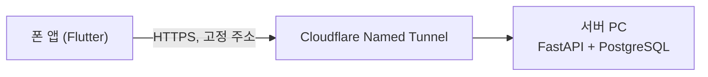





## 🇰🇷 문제
2편에서 "서비스가 안정화된 뒤 전환하겠다"고 미뤄뒀던 일을 했습니다. 개발 단계에서 쓰던 Quick Tunnel은 서버가 재시작될 때마다 주소가 바뀌었습니다. 평소엔 괜찮았지만, 네트워크 장애로 하루에도 여러 번 재시작되는 날에는 그때마다 **앱을 다시 빌드해서 배포**해야 했습니다. 이 지점이 더는 넘어가기 어려운 병목이었습니다.

## 검토: ngrok 무료 고정 도메인
포트를 고정하는 대안으로 ngrok의 무료 고정 도메인도 검토했습니다. 하지만 월 1GB 대역폭 제한이 있어서, 사진 AI입력(Gemini OCR) 트래픽을 감당하기엔 부족할 것으로 판단해 제외했습니다. 사진을 서버로 보내 분석하는 기능이 핵심 기능이라, 대역폭 제한이 있는 선택지는 처음부터 맞지 않았습니다.

## 결정: 도메인 구매 + Named Tunnel
개인 도메인(.com)을 구매해 **Named Tunnel**로 전환했습니다. 이제 서버나 네트워크가 몇 번을 재시작되든 주소는 고정이고, 앱을 다시 빌드할 필요가 없습니다.

### 도메인 TLD 선택
`.bid`, `.win` 같은 저렴한 TLD도 봤지만, 이런 TLD는 스팸에 많이 쓰여 **기업망 방화벽에서 통째로 차단되는 경우**가 있다는 걸 알게 됐습니다. 가격만 보고 고르면 나중에 "회사 와이파이에서는 접속이 안 된다" 같은 문제로 돌아올 수 있어서, 평판이 안정적인 `.com`으로 결정했습니다.

### 구매처 비교
Cloudflare Registrar와 국내 등록대행사를 비교했습니다. 최종적으로 Cloudflare Registrar에서 구매했는데, 터널도 Cloudflare 제품이라 같은 계정 안에서 DNS와 터널 설정을 한 번에 관리할 수 있다는 점이 컸습니다. 연간 비용은 1만원대 초반이었습니다.

## 전환 후

2편에서 예고한 대로, 서비스가 어느 정도 안정화된 뒤에 비용을 들였습니다. 이제 서버를 재시작해도 앱 쪽은 아무것도 바꿀 필요가 없습니다.

## 배운 점
- 대안을 검토할 땐 가격만이 아니라 **핵심 기능이 요구하는 트래픽 특성**(이 경우 사진 업로드)까지 같이 봐야 한다는 걸 ngrok 검토에서 배웠습니다.
- 가격이 싼 선택지에는 대체로 이유가 있습니다. TLD 평판 문제는 쓰기 전에는 잘 보이지 않는 종류의 위험이었습니다.
- "비용을 쓰기 전에 가치를 먼저 검증한다"는 2편의 원칙을 끝까지 지켰습니다. 안정화되지 않은 상태에서 미리 도메인을 샀다면, 서비스 방향이 바뀔 때 버리는 비용이 될 수도 있었습니다.

## 🇺🇸 Summary
Replaced the development-phase Quick Tunnel (whose address changed on every restart, forcing an app rebuild each time — painful on days with frequent network-triggered restarts) with a Cloudflare Named Tunnel behind a purchased domain. Considered ngrok's free static domain but ruled it out over its 1GB/month bandwidth cap, which wouldn't hold up against photo-upload AI input traffic. Picked `.com` over cheaper TLDs after learning that low-reputation TLDs get blocked wholesale by some corporate firewalls, and bought through the same registrar as the tunnel provider for unified DNS/tunnel management. Waited until the service proved itself before spending on this, per the principle set in post #2.
