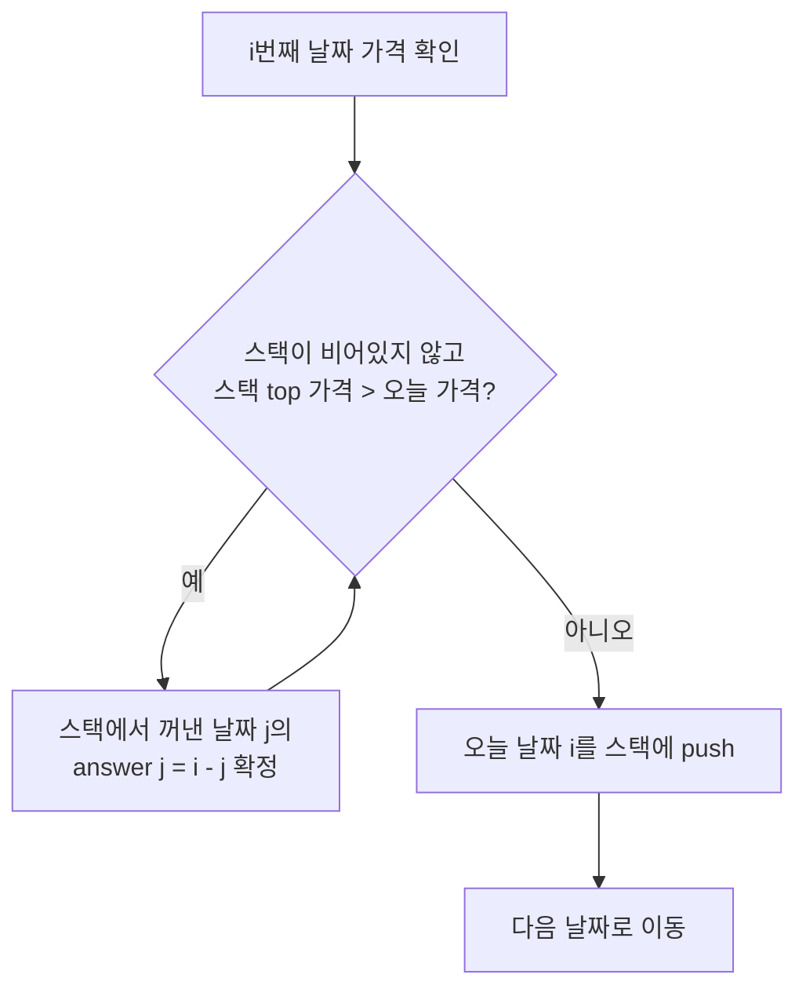



> 문제 출처는 각 플랫폼(백준·프로그래머스 등)이며, 문제 지문은 옮기지 않고 번호와 이름으로만 표시합니다.
{: .prompt-info }

1주차 다섯 번째 문제 **주식가격**(프로그래머스, 스택/큐 카테고리)을 풀면서 정리한 내용입니다.

## 문제 아이디어

초 단위로 기록된 주식가격 배열이 주어집니다. 각 시점의 가격이 **몇 초 동안 떨어지지 않고 유지되었는지**(이후에 더 낮은 가격이 나타나는 시점까지, 혹은 끝까지)를 배열로 반환하는 문제입니다.

이름이 비슷해서 헷갈릴 수 있는데, 흔히 알려진 "주식 매수/매도 최적 타이밍"(DP) 계열 문제와는 다른 유형 — 이건 **감소하는 스택(monotonic decreasing stack)**으로 푸는 문제입니다.

## 처음 시도 — 왜 막혔는가

처음엔 배열을 뒤에서부터 하나씩 꺼내면서, 남은 배열을 매번 다시 훑어 비교하는 방식으로 접근했습니다. 아이디어 자체는 "뒤에서부터 비교한다"는 방향은 맞았지만, 매 시점마다 남은 배열 전체를 다시 스캔하는 구조라 O(n²)이 되고, 리스트를 직접 변형하면서 인덱스 계산도 꼬이기 쉬워졌습니다. 이 문제는 스택으로 O(n)에 풀리는 게 포인트라, 접근 방식 자체를 바꿔야 했습니다.

## 모범답안 — 감소하는 스택

```python
def solution(prices):
    answer = [0] * len(prices)
    stack = []

    for i, price in enumerate(prices):
        # 가격이 내려갔는지 확인하는 while문
        while stack and prices[stack[-1]] > price:
            j = stack.pop()
            answer[j] = i - j
        stack.append(i)

    while stack:
        j = stack.pop()
        answer[j] = len(prices) - 1 - j

    return answer
```

### 핵심 구조 — `while`과 `append`는 서로 다른 타이밍에 동작한다

- **`while stack and prices[stack[-1]] > price:`** — 스택 맨 위 날짜의 가격이 **지금 가격보다 높을 때만**, 그 날짜를 "하락을 만났다"고 확정짓고 꺼냅니다. 조건을 만족하는 동안 여러 번 반복해서 꺼낼 수도 있고, 조건이 처음부터 거짓이면 한 번도 안 돌고 통과합니다.
- **`stack.append(i)`** — `while`이 몇 번을 돌았든 상관없이, 매 날짜마다 **무조건 한 번** 실행됩니다. "오늘은 아직 하락을 못 만났으니 기록해둔다"는 뜻입니다.

이 조건은 오직 **하락(가격이 내려갔는가)**만 감지합니다. 가격이 오르거나 유지되는 동안은 조건이 계속 거짓이라, 그냥 스택에 쌓이기만 하다가 — 하락이 발생하는 순간 쌓여있던 날짜들을 한꺼번에(조건이 맞는 만큼) 확정짓는 구조입니다. 그래서 스택 안의 값들은 항상 "아직 하락을 못 만난, 오름차순으로 쌓인 날짜들"입니다.

마지막 `while stack:`은 끝까지 하락을 못 만난(=마지막까지 가격이 유지된) 날짜들을 정리하는 부분으로, 배열의 마지막 인덱스까지 걸린 시간으로 채웁니다.

## 흐름도



## 예제로 트레이스

`prices=[1,2,3,2,3]` → 정답 `[4,3,1,1,0]`

| i | price | 스택 처리 | stack 상태(후) |
|---|---|---|---|
| 0 | 1 | 그냥 push | [0] |
| 1 | 2 | top(1)이 2보다 작아 유지 → push | [0,1] |
| 2 | 3 | top(2)이 3보다 작아 유지 → push | [0,1,2] |
| 3 | 2 | top(3)&gt;2 → pop(2), `answer[2]=3-2=1`. 다음 top(2)는 2보다 안 큼 → push | [0,1,3] |
| 4 | 3 | top(2)가 3보다 작아 유지 → push | [0,1,3,4] |
| 종료 | - | 남은 스택 역순 pop: `answer[4]=0`, `answer[3]=1`, `answer[1]=3`, `answer[0]=4` | [] |

최종 `answer = [4,3,1,1,0]` ✓

## 자바로는 이렇게 됩니다

```java
import java.util.*;

class Solution {
    public int[] solution(int[] prices) {
        int n = prices.length;
        int[] answer = new int[n];
        Deque<Integer> stack = new ArrayDeque<>();

        for (int i = 0; i < n; i++) {
            // 스택 top의 가격이 오늘 가격보다 높으면 하락을 만난 것 -> 확정
            while (!stack.isEmpty() && prices[stack.peek()] > prices[i]) {
                int j = stack.pop();
                answer[j] = i - j;
            }
            stack.push(i);   // 오늘 날짜는 아직 하락을 못 만났으니 저장
        }

        // 끝까지 하락을 못 만난 날짜들은 마지막 인덱스 기준으로 정리
        while (!stack.isEmpty()) {
            int j = stack.pop();
            answer[j] = n - 1 - j;
        }

        return answer;
    }
}
```

`Deque`를 스택으로 쓸 때는 `push`/`pop`/`peek`가 전부 **맨 앞(First)** 기준으로 동작합니다(`push`는 `addFirst`, `pop`은 `removeFirst`) — 큐로 쓸 때(`addLast`/`pollFirst`)와 정반대 방향인 점이 포인트입니다.

## `enumerate()` 메모

`for i, price in enumerate(prices):`는 리스트를 순회하며 매 원소마다 `(인덱스, 값)` 튜플을 만들어주고, 그걸 `i, price`로 바로 언패킹해서 받는 구문입니다. `for i in range(len(prices)): price = prices[i]`를 한 줄로 줄인 것과 동일합니다.

## 배운 점

- "감소하는 스택(monotonic decreasing stack)" 패턴: 스택에 쌓인 값들이 항상 오름차순을 유지하도록 관리하면서, 그 순서가 깨지는 순간(=하락)을 감지해 과거 값들을 한꺼번에 확정짓는 기법. "각 원소보다 다음에 나오는 더 작은/큰 값까지의 거리"를 구하는 문제 유형에 자주 쓰인다.
- `while`(조건부·여러 번)과 그 아래 코드(무조건·한 번)의 실행 타이밍을 분리해서 읽는 습관이 스택/큐 시뮬레이션 코드를 읽을 때 특히 중요하다.
- 처음 접근이 막히면 무리해서 그 방향을 밀어붙이기보다, "이 패턴이 효율적으로 풀리는 자료구조가 따로 있지 않을까"를 먼저 의심해보는 게 빠른 길이다.

## 🇺🇸 Summary

Solved "Stock Price" (Programmers) — for each time point, find how long the price held before a later drop (or the end of the array). Used a monotonic decreasing stack: push today's index unconditionally, but before pushing, pop and finalize any earlier index whose price is higher than today's (a drop was just found for it); whatever remains in the stack once the array ends never saw a drop and gets finalized against the last index. Clarified that the `while` loop only fires on a strict price drop and may pop zero or more times, while the `append` below it always runs exactly once per iteration regardless of what the `while` did. Noted an earlier abandoned approach (reverse the array and re-scan the remainder each time) that worked but was O(n²) and harder to index correctly, versus this O(n) stack approach. Added a Mermaid flowchart of the per-day decision process and a full trace (`[1,2,3,2,3]` → `[4,3,1,1,0]`).
