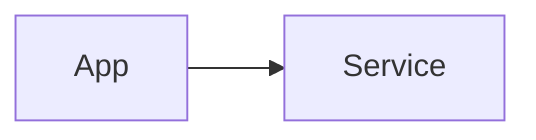

## 🇰🇷
### 한 줄 소개
### 만든 이유
### 기술 스택 / 아키텍처

### 핵심 기능
{: w="700" }
_캡션_
### 어려웠던 점과 해결
### 결과 / 링크
- GitHub: https://github.com/greenhelix/...
### 회고

## 🇺🇸 Summary
What / Why / Stack / Highlights — short English summary.
